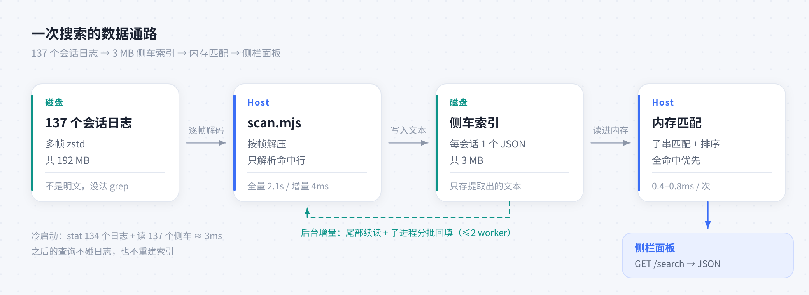

# dsh-find-history

[中文](README.md) · **English**

Adds a search icon to the "Workspaces" header in the DSH Web sidebar. Click it and the search box expands in that row, the sidebar switches to a search page, and you can search everything **you typed** across every workspace to find and open the conversation you forgot.

Median search 0.7 ms · no external index service · Chinese substring matching · zero dependencies, no build step · adapted for DSH 0.2.2

<p align="center">
  
  
  
  
</p>

<p align="center">
  
</p>
<p align="center"><sub>Results page: highlighted keywords and hover previews. The screenshot shows the 0.2.1 inline panel; since 0.2.2 the search box expands in the Workspaces header row and the sidebar becomes a search page, with the same result rows.</sub></p>

## How it differs from the built-in search

The DSH sidebar already has a search icon; it matches session titles. This plugin searches message bodies.

| | Built-in sidebar search | This plugin |
| --- | --- | --- |
| Searches | Session titles | Message text: what you typed, optionally each turn's final answer |
| Good for | You remember what the session is called | You remember a sentence but not which session it is in |

## Features

- **Millisecond results**: on one machine with one dataset, a search takes 0.7 ms median (p95 2.8 ms, worst 13 ms); comparable plugins range from 22–38 ms to 12 s.
- **Usable right after install**: no FTS dependency, no external index service. On first start a ~3 MB sidecar index is built in the background: first results after about 2 s, fully built in 4.7 s. Backfill runs in child processes; the resident host process peaks around 70 MB.
- **Only real user input is indexed**: by default only what you typed is searchable — skill catalogs and runtime-context injections from the harness do not pollute results. Tick "output" to search final answers as well.
- **VS Code semantics**: the whole typed string is one literal search string; spaces, quotes, `!` and punctuation are data. The `Aa` / `ab` / `.*` toggles only change case folding, ASCII word edges and regex interpretation. When nothing matches exactly, the search relaxes to n-gram coverage and says so in the results.
- **No Chinese tokenizer needed**: `炒股界面` matches `优化炒股界面与 K线缩放` directly; with no exact hit, overlapping character pairs (`炒股` / `股界` / `界面`) relax the search by coverage, with no odd-length special case. Whole-word mode never relaxes.
- **Explainable ordering**: time means the newest hit; relevance compares coverage first, then how often the query occurs in the Session, then recency.
- **Search box in the header row**: the field expands in the Workspaces row with the same transition the built-in search uses (title, built-in search and actions collapse), and the whole sidebar switches to the search page.
- **Keyword history**: press `↑` in the field to walk the last 10 keywords, `↓` to come back to what you were typing; stored in the browser, never in the session log.
- **Picks up where you left off**: results page with keyword highlighting and a hover preview; clicking opens the session and scrolls to the first keyword (if that message is not loaded yet, the conversation opens at the top).
- **Zero dependencies, no build**: five JS files, installable with `dsh plugin add`, no `allowBuilds` approval and no build script to run.

## Installation

After installing, refresh the page. A "Find history" entry appears on the sidebar Plugins page and can be disabled at any time.

**Install from GitHub source**

```bash
dsh plugin --profile web add github:sukirk/dsh-find-history
```

**Let an AI assistant install it**

> Install and verify this plugin following `INSTALL_GUIDE.md` in the `sukirk/dsh-find-history` repository.

The package is plain JS with no build step, so a git install needs no `allowBuilds` approval.

## Usage

Click the icon in the "Workspaces" header (a magnifier with a clock inside, placed left of the built-in search icon): the field expands in that row, the sidebar switches to the search page, and you can type a keyword. `Esc` or the `×` button clears the query and folds the row back to the session list.

| Control | Behavior |
| --- | --- |
| Scope | By default only your input; tick "output" to also search each turn's final answer |
| Spaces, quotes, `!` | Ordinary characters: `pip install` only matches the contiguous string `pip install`; it is not split into an AND; quotes and `!` carry no syntax |
| `Aa` | Match case |
| `ab` | Match whole word: the query stays one literal unit and the toggle only pins its two ASCII ends to word boundaries; spaces remain literal. Only letters, digits and underscore form a word (the `\b` rule VS Code actually applies), so `xpip`, `pip3` and `pip_installer` do not match; a Chinese keyword still matches as a contiguous substring inside Chinese prose. Whole-word mode never relaxes |
| `.*` | Regular expression; the panel reports an invalid pattern |
| Folder icon | Filter by workspace, multi-select |
| List icon | Group by session, showing where each session matched |
| Sort icon | Sort by time (default) or relevance. Time is purely chronological: Sessions by their newest match, messages inside a Session newest first; match quality never jumps the queue. Relevance compares how many query characters one message covers — a whole phrase covers all of them, scattered words only their own letters, repetition never adds up — and falls back to time |
| Row summary | Each row's excerpt and relevance badge come from the best-matching message of that Session, and the excerpt starts at the phrase, never at an earlier stray single keyword |
| Keyboard | `↑` `↓` move through results; `↑` from the first row walks the keyword history (last 10, `↓` returns to what you were typing); `Enter` opens; `Esc` closes |
| Approximate | With no exact hit, results relax to overlapping character-pair / word coverage (60% threshold); the status line says so and each row shows its coverage. Exact hits are never mixed with relaxed ones |
| Click a result | Opens the session and highlights the first keyword; archived sessions are unarchived first |
| Pagination | 24 per page, "Load more" at the bottom |

<p align="center">
  
</p>
<p align="center"><sub>Hover a result row to preview the matching message, with the hit highlighted.</sub></p>

## Performance

Measured 2026-10-28 on DSH `0.2.1-rc.4`, Linux, 142 sessions / 196 MB of compressed logs (818 MB uncompressed), same machine, median of 5 runs each.

| | **This plugin** | [Victue](https://github.com/Victue/dsh-session-search) 0.3.2 | [session-flow](https://github.com/YeqingTang/dsh-session-flow) 1.5.0 | [Ziminli](https://github.com/Ziminli/dsh-session-search) 0.1.1 |
| --- | --- | --- | --- | --- |
| Single search | **0.7 ms** (p95 2.8 ms) | 22–36 ms | 33–38 ms | 12.6 s |
| First usable | Background indexing: results in ~2 s, built in 4.7 s | Index build 5.7 s | First query 2.9–3.8 s | First success 14.5 s |
| Scope | User input (answers optional) | All message text | 20 most recent sessions | Last answer per session |

Note: the three others search different pools, so only end-to-end latency is compared, not recall coverage. Ziminli re-reads session logs on every query, so 12.6 s is inherent to that design; session-flow only scans the 20 most recent sessions (5 s budget), so older sessions never match; Victue and this plugin both maintain a local index — the difference is indexing cost and the query path.

## Privacy and data

- Reads only session logs under `~/.dsh/sessions/`; writes only under `~/.dsh/cache/find-history/`.
- The sidecar index stores your input text and the plain text of each final answer (~3 MB), not the raw logs; deleting that directory clears it.
- No external network access. Searches go through a local same-origin route, `/dsh-find-history/search`.
- Archived sessions are not indexed.

Full uninstall:

```bash
dsh plugin --profile web remove dsh-find-history && rm -rf ~/.dsh/cache/find-history
```

## Compatibility and known limits

- Adapted for the DSH `0.2.2` web profile (tested with `0.2.2-rc.3`) and needs Node ≥ 22 (it decompresses zstd frame by frame with the built-in module instead of the `zstd` command); so far only tested on Linux.
- Since 0.2.2 the search box expands in the Workspaces header row and the whole sidebar switches to the search page. Mounting relies on the sidebar's CSS-module class suffixes and the `data-sidebar-list-area` marker, so a sidebar structure change in DSH needs an update here.
- The sidebar header row has no public slot, so the entry icon is injected into the DOM. If the icon does not appear: refresh the page, then check that "Find history" is enabled on the sidebar Plugins page. A sidebar structure change in DSH will require an update here.
- Highlighting uses the browser's CSS Custom Highlight API (Chromium 105+); without it the plugin still scrolls to the first match but does not highlight.
- The output pool holds only each turn's final answer; process messages and tool calls are not indexed.
- Index build time grows linearly with the number of sessions; search is an in-memory scan, about 46 ms for 100k messages, so it stays in the millisecond range as the corpus grows.

<details>
<summary><b>How it works: why this is millisecond-fast</b></summary>



DSH writes each session to `~/.dsh/sessions/<workspace>/<session-id>/session.v4.jsonl.zstd`, a concatenation of zstd frames that cannot be searched directly. The pipeline:

1. Scan zstd frame headers (`0x28 0xb5 0x2f 0xfd`) to get frame boundaries;
2. Decompress frame by frame and parse only the lines of interest (`user/message`, `assistant/message`, `session/title`), skipping the rest;
3. Write one sidecar file per session recording bytes consumed, frame count, title and extracted text;
4. When a log grows, resume from the last byte offset and decompress only the new tail frames;
5. On first install, child processes backfill in batches (~12 MB per batch, at most 2 concurrent workers);
6. Searching scans all extracted text in memory.

| Measured | Result |
| --- | --- |
| Cold build (first install) | 142 sessions / 196 MB in ~4.7 s; starts 0.3 s after host boot |
| Later starts | No rebuild; reading sidecars takes ~3 ms |
| Session log growth | Only new frames decompressed, ~4 ms |
| Single search (with title and workspace) | 0.7 ms median, p95 2.8 ms |
| Disk usage | ~3 MB of sidecar index (raw logs are not copied) |

See [CONTRIBUTING.md](CONTRIBUTING.md) for the diagrams and development notes.

</details>

## Development and tests

```bash
npm test                                  # node --test: behaviour, ordering, 20 acceptance queries (28 tests)
node --check index.mjs scan.mjs store.mjs backfill.mjs client.js
node scripts/bench-search.mjs             # synthetic 20k-message search benchmark
```

Pass an older `index.mjs` to compare: `node scripts/bench-search.mjs /path/to/old-index.mjs`.

Release history: [CHANGELOG.md](CHANGELOG.md).

## License

[MIT](LICENSE)
