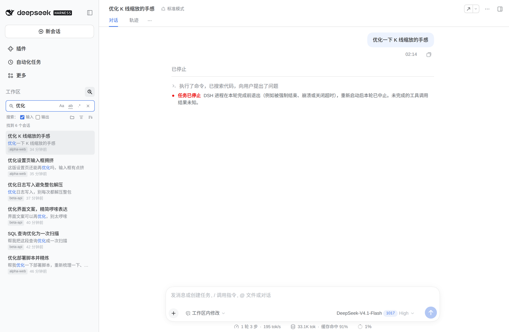

# dsh-session-history-search · Session History Search

Adds a search icon to the Workspaces header in the DSH Web sidebar. Type a few words you remember writing, and it finds that forgotten conversation across **every** workspace so you can pick it up again.

CJK-friendly, millisecond-fast, zero dependencies, no full-text index service required.



> 中文说明见 [README.md](README.md)

## How it compares

| | **this plugin** | [dsh-session-search](https://github.com/Ziminli/dsh-session-search) | [dsh-session-search-pro](https://github.com/LeslieWylie/dsh-session-search-pro) | [dsh-companion](https://github.com/beijingwahw/dsh-companion) |
| --- | --- | --- | --- | --- |
| Entry point | Header icon + **inline panel in the sidebar** | Sidebar panel + Ctrl+F | No UI, 3 agent tools | One module of a suite |
| Audience | Humans finding old sessions | Humans | The model | Humans |
| Data source | **Reads session logs directly** (zstd frame-level deltas + per-session sidecar) | DSH `session-query` services | `sessionQuery` FTS5, falls back to scanning | `sessionQuery` |
| Needs a full-text index service | **No** | Yes | Yes (else degraded) | Yes |
| CJK substring search | **Substring scan + 2-char chunk fallback** | Engine tokenizer | Engine tokenizer | Engine tokenizer |
| Input / output pools | **Input by default, output optional** | final-only option | tool args | partial |
| First index build | **~2s** (child-process backfill, parent RSS < 100MB) | engine-dependent | engine-dependent | engine-dependent |
| Per-query latency | **2–15 ms** (measured) | 3.5–4 s on the same machine | not measured | not measured |
| Dependencies | **5 JS files, no deps, no build step** | medium | small | large suite |

The competitor numbers come from the same local dataset (134 sessions / 774 user inputs / 751 answers) and are indicative only. The competitors are stronger in breadth (fuzzy matching, typo tolerance, time ranges, multi-session selection, agent tools); this plugin deliberately does one thing — fast recall.

## Install

```bash
# from npm (once published)
dsh plugin --profile web add dsh-session-history-search

# from source
dsh plugin --profile web add github:OWNER/dsh-session-history-search

# from a local checkout or tarball
dsh plugin --profile web add /path/to/dsh-session-history-search
```

Restart `dsh web` (or reload the page), then enable/disable it under **Settings → Plugins**. A plain-JS package, so git installs need no `allowBuilds` permission.

Prefer to let an agent do it:

> Install and verify the plugin by following `OWNER/dsh-session-history-search/INSTALL_GUIDE.md`.

## Usage

- Click the new icon in the Workspaces header (magnifier with a clock hand, distinct from the built-in title search).
- Type to search (260ms debounce). Multiple keywords must all appear in the same message; long CJK strings fall back to 2-char chunks.
- Inline toggles: `Aa` case-sensitive, `ab` whole word, `.*` regex.
- Second row: `Search: ☐ input ☐ output`; on the right, workspace multi-select, group-by-session, and sort (time / relevance).
- Hover a row for a preview of the matched message (100 chars before + match + 100 after, highlighted).
- Click a row to open that session; archived sessions are excluded. `Esc` closes, and your query is kept for next time.

## Why it is fast

DSH stores each session as a **multi-frame** zstd file at `~/.dsh/sessions/<workspace>/<session-id>/session.v4.jsonl.zstd`. The plugin never decompresses the whole log:

1. scan zstd frame headers (`0x28 0xb5 0x2f 0xfd`) to get frame boundaries;
2. decompress frame by frame and parse **only** the lines it needs (`user/message`, `assistant/message`, `session/title`), skipping the rest;
3. keep one **sidecar** per session under `~/.dsh/cache/session-history-search/` (bytes consumed, frame count, title, extracted messages);
4. when a log grows, **continue from the last byte offset** instead of rescanning;
5. first install backfills in **child processes** (≈12MB batches, at most 2 workers) so the host process stays small;
6. searching is then an in-memory substring scan over a few hundred messages — about 0.1ms.

Measured on 134 sessions (193MB compressed, 818MB decompressed):

| Task | Result |
| --- | --- |
| Cold build (first install) | ~2.1s, parent RSS < 100MB |
| Second start (sidecars present) | no rebuild, ~3ms |
| One session grew | decompress only new frames, ~4ms |
| Single search (titles included) | 2–15ms |
| In-memory scan | 0.13ms for 751 messages, 46ms for 100k |
| Disk | ~2.5MB of sidecars |

### Why not FTS, why not ripgrep

DSH's `session-query` uses SQLite FTS5 with `unicode61`: consecutive CJK becomes a single token, so 2-character Chinese substrings rarely match. It also indexes **every** `user/message` event, including Harness-injected runtime context and skill catalogs, so many "hits" contain none of your words. `ripgrep` is great on plain text (782MB in ~79ms) but session logs are compressed — scanning them costs a decompression per query (1.18s), and keeping a decompressed mirror costs disk. An in-memory scan is two orders of magnitude faster.

Note: Node 22's `zlib.zstdDecompressSync` / `createZstdDecompress` only decode the **first frame** (198 bytes out of a 14MB log, silently). Hence the manual frame walking.

## Privacy

Reads only `~/.dsh/sessions/`, writes only `~/.dsh/cache/session-history-search/`, makes no network requests, never modifies session logs. Delete the cache directory to forget everything.

## Compatibility

- Requires DSH 0.2.1-rc.x (`engines.dsh: >=0.2.1-rc.1 <0.3.0`).
- UI is Web-profile only.
- The Workspaces header is rendered by a shipped component with no public slot, so the entry icon is **portal-injected** next to it — only its own DOM node is added, and it is removed on unload.

## License

MIT
