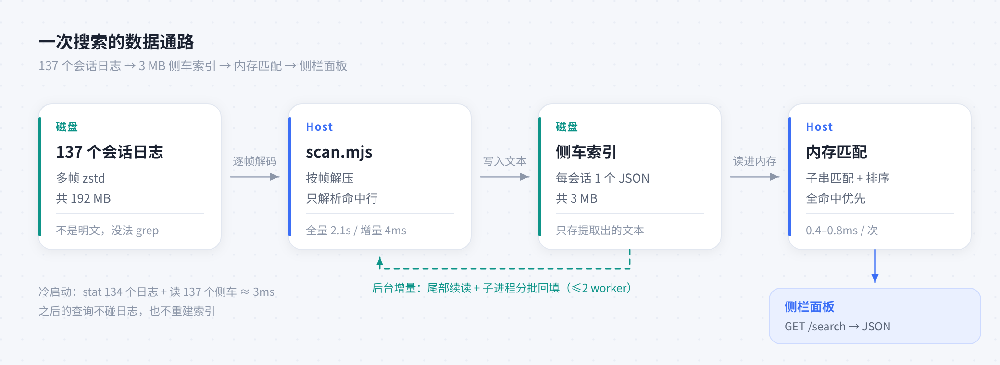

# dsh-find-history · 查找历史

**中文** · [English](README.en.md)

在 DSH Web 侧栏「工作区」标题行注入一个检索图标：点击后搜索框就在这一行里原地展开，整个侧栏切换到搜索页，跨所有工作区搜索**你输入过的内容**，定位并打开那个忘记的会话。

单次搜索中位 0.7ms · 无外部索引服务 · 中文子串匹配 · 零依赖、无构建 · 已适配 DSH 0.2.2

<p align="center">
  
  
  
  
</p>

<p align="center">
  
</p>
<p align="center"><sub>结果页：关键词高亮、悬停预览；截图为 0.2.1 的内联面板，0.2.2 起搜索框在「工作区」标题行内展开，结果区样式不变。</sub></p>

## 与自带搜索的分工

DSH 侧栏已有一个搜索图标，它按会话标题匹配；本插件检索的是消息正文。

| | 侧栏自带搜索 | 本插件 |
| --- | --- | --- |
| 检索对象 | 会话标题 | 消息正文：你输入的内容，可选每轮回答 |
| 适用场景 | 记得会话叫什么 | 记得某句话，但忘了它在哪个会话 |

## 优点

- **毫秒级返回**：同一台机器、同一份数据，单次检索中位 0.7ms（p95 2.8ms，最差 13ms）；同类插件在 22–38ms 到 12s 区间。
- **安装后即可用**：不依赖 FTS，也没有外部索引服务。首次启动在后台构建约 3MB 的侧车索引，约 2s 出首批结果、4.7s 建完；回填在子进程中完成，Host 常驻内存峰值约 70MB。
- **只索引真实输入**：默认只收录你输入的内容，技能目录、运行时上下文这类 Harness 注入不会混进结果；需要检索回答时勾选「输出」。
- **查询语义对齐 VS Code**：整段输入当作一个字面量，空格、引号、`!`、标点都是数据；`Aa` / `ab` / `.*` 三个开关只改大小写、ASCII 词边界和正则解释，不改变查询结构。没有精确结果时自动放宽为 n-gram 覆盖率近似匹配，并在结果上方与行内标明。
- **中文无需分词**：`炒股界面` 直接命中「优化炒股界面与 K线缩放」；没有精确结果时按重叠字对（`炒股` / `股界` / `界面`）的覆盖率放宽，奇数长度没有特殊规则。整词模式不参与放宽。
- **排序可解释**：按时间就是最新命中；按相关度先比覆盖率，再比整段查询在会话里出现了多少次，最后比时间。
- **结果行对齐命中**：每行的摘录与「整句匹配」徽标取自该会话里匹配质量最高的那条消息，摘录从整句处起显示，不会被同一条消息里更早出现的单关键词带偏。
- **搜索框在标题行**：点击图标后在「工作区」这一行原地展开，标题、内置搜索与操作按钮按内置搜索的同一套过渡收起，侧栏整块切到搜索页。
- **关键词历史**：输入框里按 `↑` 回看最近 10 条搜索词，`↓` 回到正在输入的内容；存在浏览器本地，不写会话日志。
- **结果可直接续聊**：结果页关键词高亮，悬停预览命中原文；点击打开会话并滚动到首个关键词处高亮（命中消息尚未加载时停在会话顶部）。
- **零依赖、无构建**：5 个 JS 文件，`dsh plugin add` 直接安装，无需 `allowBuilds`，没有需要运行的构建脚本。

## 安装

安装完成后刷新页面，侧栏「插件」页会出现「查找历史」，可随时停用。

**从 GitHub 源码安装**

```bash
dsh plugin --profile web add github:sukirk/dsh-find-history
```

**交由 AI 助手安装**

> 根据 `sukirk/dsh-find-history` 仓库中的 INSTALL_GUIDE.md 安装并验证该插件。

包为纯 JS、无构建步骤，git 安装无需授权 `allowBuilds`。

## 用法

点击「工作区」标题行的图标（放大镜内含时钟，排在自带搜索图标左侧）：搜索框在这一行展开、侧栏切换到搜索页，输入关键词即可；`Esc` 或右侧 `×` 清空并收起，回到会话列表。

| 操作 | 说明 |
| --- | --- |
| 检索范围 | 默认只搜你的输入；勾选「输出」后同时搜每轮最终回答 |
| 空格 / 引号 / `!` | 都是普通字符：`pip install` 只匹配连续出现的 `pip install`，不会拆成两个词做 AND；引号和 `!` 不会被当成语法 |
| `Aa` | 区分大小写 |
| `ab` | 整词匹配：查询文本当作一整段字面量，开关只在首尾校验 ASCII 词边界；空格仍是字面量。词边界只认字母、数字、下划线（VS Code 的 `\b` 实际行为），`xpip`、`pip3`、`pip_installer` 不算整词；中文两侧没有这种边界，`历史搜索` 在「会话历史搜索插件」里仍按连续子串命中。整词模式**不启用近似放宽** |
| `.*` | 正则，输入不合法时面板会提示 |
| 文件夹图标 | 按工作区筛选，可多选 |
| 列表图标 | 按会话分组，显示每会话的命中位置 |
| 排序图标 | 按时间（默认）或按相关度。按时间就是纯时间：会话按最新命中的消息排序，会话内的消息也从新到旧，不再让「整句/字数」插队。按相关度先比「一条消息覆盖了多少查询字符」——整句覆盖全部字符，散开的词只算各自的字母，重复命中不累加——覆盖一样多再按时间 |
| 键盘 | `↑` `↓` 选择结果；`↑` 从第一行再按进入关键词历史（最近 10 条，`↓` 回到正在输入的内容）；`Enter` 打开；`Esc` 关闭 |
| 近似匹配 | 精确命中为空时自动放宽：按查询的重叠字对 / 词的覆盖率（阈值 60%）匹配，结果上方提示“近似匹配”，每行显示覆盖率；精确命中存在时不会混入近似结果 |
| 点击结果 | 打开会话并高亮首个关键词；归档会话会先自动解除归档 |
| 分页 | 每页 24 条，底部「加载更多」 |

<p align="center">
  
</p>
<p align="center"><sub>悬停结果行可预览命中原文，命中处高亮。</sub></p>

## 性能对比

测量条件：2026-10-28，DSH `0.2.1-rc.4`，Linux，142 个会话 / 196MB 压缩日志（解压 818MB），同一台机器，各取 5 次中位。

| | **本插件** | [Victue](https://github.com/Victue/dsh-session-search) 0.3.2 | [session-flow](https://github.com/YeqingTang/dsh-session-flow) 1.5.0 | [Ziminli](https://github.com/Ziminli/dsh-session-search) 0.1.1 |
| --- | --- | --- | --- | --- |
| 单次检索 | **0.7ms**（p95 2.8ms） | 22–36ms | 33–38ms | 12.6s |
| 首次可用 | 后台建索引，约 2s 出结果、4.7s 建完 | 建索引 5.7s | 首查 2.9–3.8s | 首次成功 14.5s |
| 检索范围 | 用户输入（可选回答） | 全库正文 | 最近 20 个会话 | 每会话最后一条回答 |

说明：三者检索范围不同，因此只比较端到端耗时，不比较召回覆盖率。Ziminli 每次查询都重读会话日志，12.6s 是这种实现方式的固有成本；session-flow 每次仅扫描最近 20 个会话（5 秒预算），较早的会话不会命中；Victue 与本插件都维护本地索引，差别在索引成本与查询路径。

## 隐私与数据

- 只读取 `~/.dsh/sessions/` 下的会话日志，只写入 `~/.dsh/cache/find-history/`。
- 侧车索引包含你输入过的文本和每轮回答的纯文本（约 3MB），不含日志原文；删除该目录即清空。
- 不访问外部网络。检索请求走本地同源路由 `/dsh-find-history/search`。
- 归档会话不进索引。

彻底卸载：

```bash
dsh plugin --profile web remove dsh-find-history && rm -rf ~/.dsh/cache/find-history
```

## 兼容性与已知限制

- 适配 DSH `0.2.2` 的 web profile（实测 `0.2.2-rc.3`），需要 Node ≥ 22（用内置 zstd 逐帧解压，不依赖 `zstd` 命令）；目前只在 Linux 上实测。
- 0.2.2 起搜索框直接在「工作区」标题行内展开、侧栏整块切为搜索页；挂载依赖侧栏 CSS module 的类名后缀与 `data-sidebar-list-area` 标记，宿主侧栏结构变化时需要适配。
- 侧栏标题行没有公开插槽，入口图标通过注入 DOM 实现。若图标未出现：先刷新页面，再确认侧栏「插件」页里「查找历史」处于启用状态。DSH 侧栏结构变更时这里需要适配。
- 高亮依赖浏览器的 CSS Custom Highlight API（Chromium 105+）；不支持时只滚动定位、不高亮。
- 输出池仅收录每轮最终回答，过程消息与工具调用不入库。
- 索引构建时间随会话数线性增长；检索是内存扫描，10 万条消息约 46ms，会话规模增大时检索仍是毫秒级。

<details>
<summary><b>实现原理：为什么是毫秒级</b></summary>



DSH 将会话写入 `~/.dsh/sessions/<workspace>/<session-id>/session.v4.jsonl.zstd`，为多帧 zstd 拼接格式，无法直接检索。处理流程：

1. 扫描 zstd 帧头（`0x28 0xb5 0x2f 0xfd`）获取帧边界；
2. 逐帧解压后仅解析目标类型的行（`user/message`、`assistant/message`、`session/title`），其余行跳过；
3. 每个会话生成一个侧车文件，记录已读取字节数、帧数、标题与提取出的文本；
4. 日志增长时从上次字节位置续读，仅解压尾部新增帧；
5. 首次安装由子进程分批回填（每批约 12MB，最多 2 个并发 worker）；
6. 检索阶段在内存中扫描全部提取文本。

| 实测项 | 结果 |
| --- | --- |
| 冷建（首次安装） | 142 个会话 / 196MB 约 4.7s；Host 启动 0.3s 后自动开始 |
| 再次启动 | 不重建，读取侧车约 3ms |
| 会话日志增长 | 仅解压新增帧，约 4ms |
| 单次检索（含标题、工作区） | 中位 0.7ms，p95 2.8ms |
| 磁盘占用 | 侧车索引约 3MB（不复制日志正文） |

示意图与开发说明见 [CONTRIBUTING.md](CONTRIBUTING.md)。

</details>

## 开发与测试

```bash
npm test                                  # node --test：行为、排序与 20 条验收查询（共 35 例）
node --check index.mjs scan.mjs store.mjs backfill.mjs client.js
node scripts/bench-search.mjs             # 2 万条消息的合成检索基准
```

基准脚本可传一个旧版 `index.mjs` 路径对比：`node scripts/bench-search.mjs /path/to/old-index.mjs`。

更新日志见 [CHANGELOG.md](CHANGELOG.md)。

## License

[MIT](LICENSE)
